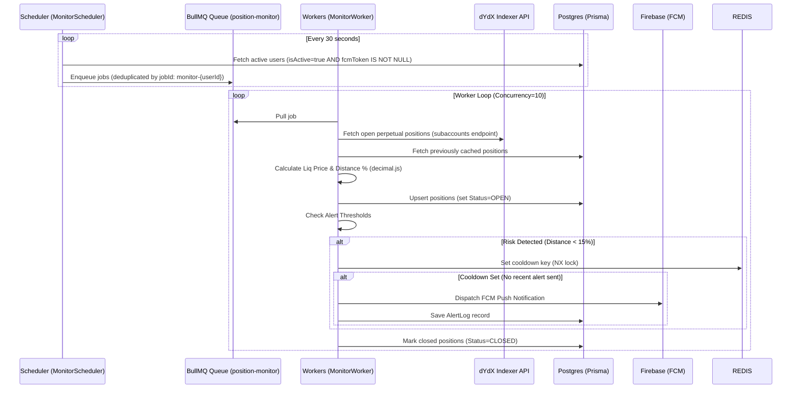

# dYdX v4 Perpetual Positions Liquidation Risk Monitor

A production-grade, fully autonomous NestJS backend that monitors active dYdX v4 perpetual positions, performs high-precision financial liquidation calculations using `decimal.js`, and dispatches push notification alerts (via Firebase FCM) when accounts approach liquidation thresholds.

---

## 1. Prerequisites

Before setting up the project, ensure you have:
*   **Node.js**: version `20.x` or higher
*   **PostgreSQL**: A hosted database instance on [Neon.tech](https://neon.tech/) (or any PostgreSQL provider)
*   **Redis**: A hosted Redis database on [Upstash](https://upstash.com/) (configured with SSL/TLS)
*   **Firebase Project**: A Firebase project with Cloud Messaging (FCM) enabled. Generate and download a Service Account credentials JSON file.

---

## 2. Step-by-Step Setup

1.  **Clone / Copy the codebase** to your local machine.
2.  **Initialize Environment Variables**:
    Copy `.env.example` to `.env`:
    ```bash
    cp .env.example .env
    ```
    Open `.env` and fill in the configuration details:
    *   `DATABASE_URL`: Your PostgreSQL connection string.
    *   `REDIS_URL`: Your Upstash Redis connection string (should start with `rediss://` for TLS).
    *   **Firebase Auth Configuration**:
        *   *Option A (Recommended)*: Paste the **entire Firebase Service Account JSON string** onto a single line under `FIREBASE_SERVICE_ACCOUNT_JSON` enclosed in single quotes.
        *   *Option B*: Fill in individual properties: `FIREBASE_PROJECT_ID`, `FIREBASE_CLIENT_EMAIL`, and `FIREBASE_PRIVATE_KEY` (make sure linebreaks are represented as `\n`).

3.  **Install Dependencies**:
    ```bash
    npm install
    ```

4.  **Database Migration & Client Generation**:
    Create database tables and generate the type-safe Prisma client:
    ```bash
    npx prisma migrate dev --name init
    ```

5.  **Start the Server**:
    *   Development mode with auto-reload:
        ```bash
        npm run start:dev
        ```
    *   Production build & start:
        ```bash
        npm run build
        npm run start:prod
        ```

---

## 3. How to Register a User

Once the server is running on `http://localhost:3000`, users must register their wallet address and FCM registration token to receive liquidation alerts.

### Register a User / Update FCM Token
```bash
curl -X POST http://localhost:3000/users/register \
  -H "Content-Type: application/json" \
  -d '{
    "walletAddress": "0x4386419515598E9B663a75069B7Ad1f7447d6E0a",
    "fcmToken": "fcm_registration_token_here"
  }'
```

**Response**:
```json
{
  "id": "7ca641a2-850f-48d6-95ff-434fe9ff04b2",
  "walletAddress": "0x4386419515598e9b663a75069b7ad1f7447d6e0a",
  "createdAt": "2026-05-23T11:00:00.000Z"
}
```

### Update FCM Token Separately
```bash
curl -X PATCH http://localhost:3000/users/0x4386419515598E9B663a75069B7Ad1f7447d6E0a/token \
  -H "Content-Type: application/json" \
  -d '{
    "fcmToken": "new_fcm_token_here"
  }'
```

**Response**:
```json
{
  "success": true
}
```

### Get Active Positions & Recalculate Risk Levels
Retrieves cached positions and calculates the live distance and risk tier:
```bash
curl http://localhost:3000/users/0x4386419515598E9B663a75069B7Ad1f7447d6E0a/positions
```

---

## 4. How the 30-Second Monitor Cycle Works

The background monitoring system is completely autonomous and utilizes a **Producer-Consumer** architecture powered by **BullMQ** and a shared **ioredis** connection.



### High-precision Risk Math
*   **Maintenance Margin Requirement (MMR)**:
    $$\text{MMR} = \text{size} \times \text{oraclePrice} \times \text{maintenanceMarginFraction}$$
*   **Liquidation Price (Long)**:
    $$\text{Liquidation Price} = \text{entryPrice} - \frac{\text{margin} - \text{MMR}}{\text{size}}$$
*   **Liquidation Price (Short)**:
    $$\text{Liquidation Price} = \text{entryPrice} + \frac{\text{margin} - \text{MMR}}{\text{size}}$$
*   **Distance Percentage**:
    $$\text{Distance \%} = \frac{|\text{oraclePrice} - \text{liquidationPrice}|}{\text{oraclePrice}} \times 100$$

---

## 5. How to Adjust Risk Thresholds and Cooldowns

### Adjusting Risk Thresholds
The distance percentages mapped to specific alert tiers are defined in `src/modules/risk/risk.service.ts`:
```typescript
assessRisk(distancePct: Decimal): AlertType | null {
  if (distancePct.lt(3)) {
    return AlertType.CRITICAL; // Triggered if under 3% from liquidation
  }
  if (distancePct.lt(7)) {
    return AlertType.DANGER;   // Triggered if under 7% from liquidation
  }
  if (distancePct.lt(15)) {
    return AlertType.WARNING;  // Triggered if under 15% from liquidation
  }
  return null; // Above 15%: safe, no alert
}
```
*To change the thresholds, modify the numerical values passed to `.lt(threshold)`.*

### Adjusting Alert Fatigue Cooldowns
To prevent spamming push alerts, the worker writes a temporary key to Redis using `SET NX` before triggering notifications.
The TTLs (cooldown periods) are configured in `src/modules/monitor/monitor.worker.ts`:
*   `CRITICAL` alert cooldown: **120 seconds** (2 minutes)
*   `DANGER` alert cooldown: **300 seconds** (5 minutes)
*   `WARNING` alert cooldown: **600 seconds** (10 minutes)

```typescript
let ttlSeconds = 600; // Default for WARNING
if (alertType === 'DANGER') {
  ttlSeconds = 300;
} else if (alertType === 'CRITICAL') {
  ttlSeconds = 120;
}
```
*To adjust the frequency of alerts per position tier, modify the `ttlSeconds` values.*
